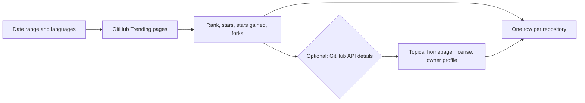

# GitHub Trending Repos Scraper with Stars, Topics and Owner Details

[](https://apify.com/Turboextract/github-trending-repos)
[](LICENSE)
[](#pricing)

**Get GitHub's trending repositories for today, this week or this month, in any programming language: rank, total stars, stars gained, forks, description and top contributors.** Turn on details to add topics, homepage, license, issues, dates and the owner's public name, company, website, location, email and X profile.

GitHub Trending is where new developer tools break out. In one week in November 2026, the top Python repo gained 4,355 stars and Anthropic's skills repo gained 5,666. Catching those projects early is worth a lot to dev-tool companies, investors and newsletter writers.

**Try it now →** [apify.com/Turboextract/github-trending-repos](https://apify.com/Turboextract/github-trending-repos)

---

## Why this exists

- GitHub Trending is where new developer tools break out, but it has no API and no history.
- The page shows stars gained, not who owns the project or how to reach them.
- Owner company, website and public email are only available one profile at a time.
- Open-source analytics platforms are priced for enterprises.

---

## Who this is for

- **Developer-tool startups** finding fast-growing projects to integrate with or sponsor
- **VCs and scouts** tracking breakout open-source projects before they raise
- **Newsletter and content creators** writing weekly "what's trending" roundups
- **DevRel and recruiting teams** finding active maintainers in a language
- **Analysts** measuring which languages and topics are gaining momentum

---

## What you get per repository

```json
{
  "rank": 2,
  "fullName": "anthropics/skills",
  "url": "https://github.com/anthropics/skills",
  "description": "Public repository for Agent Skills",
  "language": "Python",
  "stars": 196644,
  "forks": 23060,
  "starsInPeriod": 5666,
  "period": "weekly",
  "trendingLanguage": "Python",
  "builtBy": ["contributor1", "contributor2"]
}
```

With **Include repo and owner details** each row also gets `topics`, `homepage`, `license`, `openIssues`, `createdAt`, `pushedAt`, `ownerType` and an `ownerProfile` with name, company, website, location, public email, X profile and followers.

---

## How it works



Trending data comes from github.com/trending. Details come from the official GitHub REST API.

---

## Quick start

1. Click **Try for free**.
2. Pick **Today**, **This week** or **This month**.
3. Optional: add **Programming languages** like `Python` and `Rust`, or **Keywords** like `agent`.
4. Click **Start**. Schedule it daily to build a history of what trended.

### API

```bash
curl -X POST "https://api.apify.com/v2/acts/Turboextract~github-trending-repos/run-sync-get-dataset-items?token=YOUR_TOKEN" \
  -H "Content-Type: application/json" \
  -d '{
    "since": "weekly",
    "languages": ["Python", "TypeScript", "Rust"]
  }'
```

### Python

```python
from apify_client import ApifyClient

client = ApifyClient("YOUR_TOKEN")
run = client.actor("Turboextract/github-trending-repos").call(run_input={
    "since": "daily",
    "keywords": ["agent", "llm"],
    "includeDetails": True,
    "githubToken": "YOUR_GITHUB_TOKEN",
})
for repo in client.dataset(run["defaultDatasetId"]).iterate_items():
    print(repo["rank"], repo["fullName"], repo["starsInPeriod"], repo.get("homepage"))
```

---

## Input fields

| Field | Default | What it does |
|---|---|---|
| `since` | daily | daily, weekly or monthly |
| `languages` | all | e.g. Python, Go, Rust |
| `spokenLanguage` | – | README language code, e.g. en, zh |
| `minStars` | 0 | Minimum total stars |
| `keywords` | – | Match name or description |
| `includeDetails` | false | Topics, homepage, license, owner profile |
| `githubToken` | – | Optional, raises GitHub's limit to 5,000 requests an hour |
| `maxResults` | 200 | Cap per run |

---

## Pricing

**$0.003 per repository delivered.** A daily run across 10 languages, about 250 repos, costs $0.75.

| Option | 1,000 trending repos |
|---|---|
| **GitHub Trending Repos** | **$3**, owner details included |
| Other trending actors on Apify | $1.15 to $30 |
| Open-source analytics platforms | Monthly subscriptions |
| Checking the trending page by hand | Every day |

---

## Common use cases

- **Weekly newsletter**: top 10 repos per language with stars gained and homepage
- **Partnership pipeline**: trending projects in your ecosystem and their maintainers' websites
- **Deal flow**: repos owned by organizations with a homepage and fast star growth
- **Trend research**: which topics trend most often over a month
- **Hiring**: active maintainers in a language who just shipped something popular

---

## Tips for best results

- Schedule it daily and keep the rows to build your own trending history.
- Add a free GitHub token when you turn on details, so the API limit never cuts rows short.
- Use several `languages` in one run, duplicates are removed.
- Use `keywords` like agent or database to stay in your niche.

---

## Pairs well with

- [Y Combinator Company Leads](https://apify.com/Turboextract/yc-company-leads): YC startups with founders and LinkedIn
- [Hacker News Hiring Leads](https://apify.com/Turboextract/hn-hiring-leads): startups hiring developers this month
- [Chrome Web Store Scraper](https://apify.com/Turboextract/chrome-extension-leads): extensions with users and developer contacts

---

## FAQ

**Do I need a GitHub token?** Only for details. GitHub allows 60 anonymous API requests an hour per IP, and shared cloud IPs often use that up. A free token with no scopes gives 5,000 an hour. Trending data itself never needs a token.

**How many repos per language?** GitHub shows up to 25 trending repos per language and date range.

**Is the owner email always there?** Only when the owner made it public on their GitHub profile.

**Is it legal?** The actor reads the public trending page and the official GitHub API under its rate limits.

---

## SEO keywords

GitHub trending scraper, GitHub trending API, trending repositories, GitHub trending by language, scrape GitHub trending, open source trends, GitHub stars tracker, trending developers, GitHub repo data, GitHub owner email

---

## Support

- Actor page: https://apify.com/Turboextract/github-trending-repos
- Issues and questions: open an issue in this repo
- Community Discord: https://discord.gg/8SrXSCpvgj

Built and maintained by [Turboextract](https://apify.com/Turboextract) on the Apify platform.

---

## License

The documentation and examples in this repository are MIT licensed. The actor itself runs on the Apify platform.
